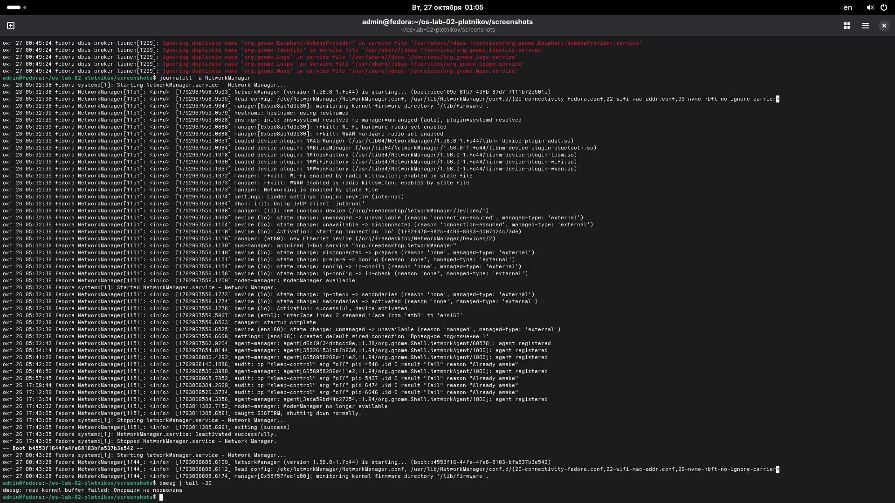

# Задание 4. Чтение журналов

## 1. Ошибки в текущей загрузке
При выполнении команды `journalctl -b -p err` были обнаружены следующие ошибки (уровня err):
`dbus-broker-launch[1290]: Ignoring duplicate name 'org.gnome...' in service file ...`
Эти ошибки связаны с шиной D-Bus (механизм взаимодействия между программами). Служба `dbus-broker` сообщает, что пытается зарегистрировать имя для сервисов GNOME (Epiphany, Logs, Maps и др.), которое уже занято. Это не критическая ошибка, система продолжает работать нормально.

Также при попытке выполнить `dmesg | tail -30` от имени обычного пользователя появилась ошибка `read kernel buffer failed: Операция не допускается`. Это связано с политикой безопасности ядра (kernel.dmesg_restrict), которая запрещает обычным пользователям читать буфер ядра, чтобы предотвратить утечку информации.

## 2. Разбор одного сообщения
В журнале службы `NetworkManager` (команда `journalctl -u NetworkManager`) можно увидеть сообщение:
`NetworkManager[115]: <info> [1792769598.9593] Starting NetworkManager.service...`
Это означает, что служба управления сетями NetworkManager успешно запускается. Она сообщает о начале своей работы, после чего инициализирует устройства и подключает сеть.

## 3. Отличие journalctl -b от journalctl -b -1
*   `journalctl -b` показывает журнал **текущей** загрузки системы (от момента включения до сейчас).
*   `journalctl -b -1` показывает журнал **предыдущей** загрузки.
Второй вариант (`-1`) необходим в том случае, если система упала, зависла или не загрузилась. Если ты перезагрузил машину после сбоя, текущая загрузка будет чистой, и чтобы найти причину падения, нужно смотреть логи *предыдущего* запуска.

## Скриншоты

